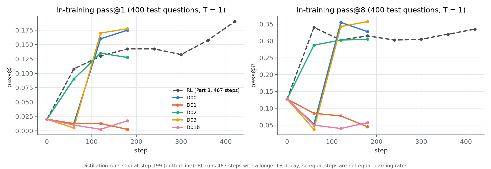
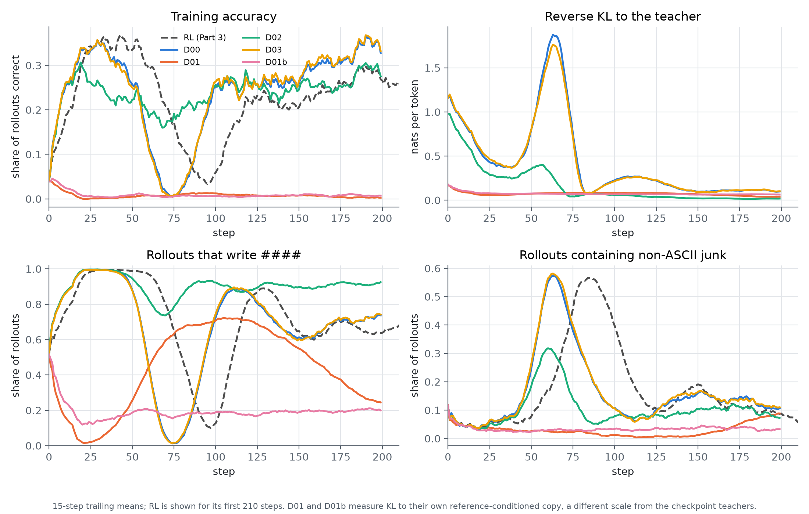
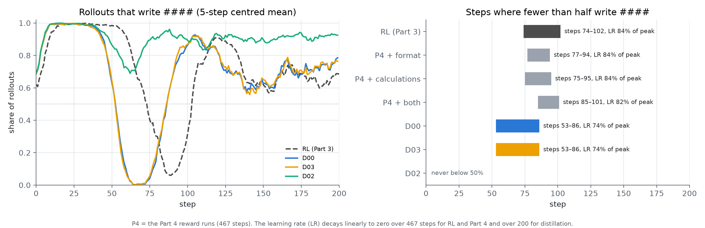
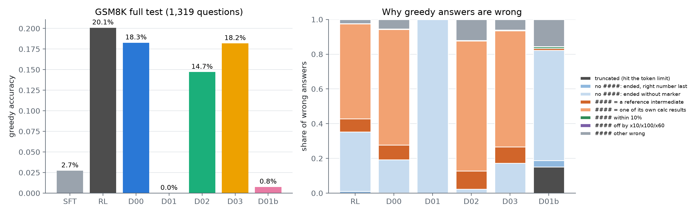
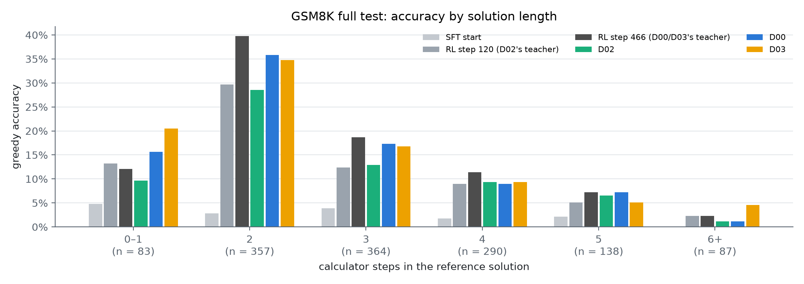
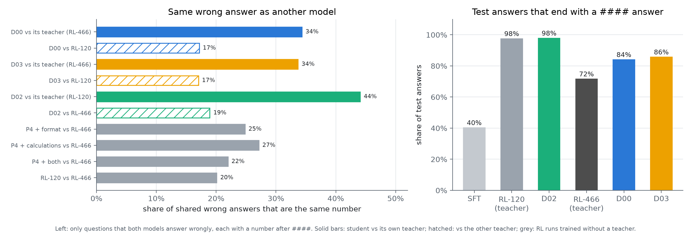

# Part 5: On-Policy Distillation

**Key findings:**

- Distilling our Part 3 RL model into a fresh copy of the SFT model (run D00) reached 18.27% on the GSM8K test set, against 20.09% for RL. The gap is not statistically significant (p = 0.076). D00 used 43% of RL's training samples and about half its training time, but it needed the finished RL model as its teacher.
- The student follows its teacher closely. With a weaker teacher (RL step 120, 14.94%), the student reached 14.71%. Students also copy their own teacher's mistakes: when a student and its teacher are both wrong, they give the same wrong number about twice as often as the student and the other teacher do.
- Distillation did not prevent the training collapse seen in Parts 3 and 4. D00 broke down into unreadable text between steps 53 and 86, earlier than any RL run, and then recovered by itself. Adding the RL reward to distillation (D03) changed almost nothing.
- Self-distillation in the style of SDPO failed. When the teacher was the student itself with the reference solution in its prompt (D01), the student learned to answer every question with the teacher's instruction, "Correctly solve the original question." (0.00%). A follow-up run with the SDPO paper's own setting for small models (D01b) also failed (0.76%).
- Distilled models give up less often than RL but choose the wrong quantity more often: 19% of D00's wrong answers stop without a final answer (RL: 34%), while 67% report one of its own intermediate results (RL: 55%). D00 also lost slightly more than RL on the multiple-choice and coding tasks.

## 5.1: Method and Hypothesis

**Choice of method:** We use on-policy distillation as described by Thinking Machines Lab (2025), an approach that goes back to GKD (Agarwal et al., 2024) and MiniLLM (Gu et al., 2024). The student model writes its own answers, exactly as in RL. A frozen teacher model then reads each answer and gives a probability to every token the student wrote. The student is trained to make its own probabilities match the teacher's on those tokens. In RL, an answer gets one reward at the end, and Part 3 found that half of all 16-answer groups gave no learning signal because every answer in the group got the same reward. In distillation every token gets its own signal, even in groups where every answer is wrong.

**Choice of teacher:** The teacher must use the same tokenizer as the student, because the two models are compared token by token. Karpathy's released nanochat models use a 65,536-token vocabulary, while our model uses 32,768 tokens (Part 3), so they cannot be teachers. The strongest model with our tokenizer is our own Part 3 RL model (step 466, 20.09%), so it is the main teacher. As an ablation we also test SDPO (Hübotter et al., 2026), where the teacher is the student itself, given extra information in its prompt.

**How the update works:** Our trainer, a4/part-5-distill/chat_distill.py, is a copy of nanochat's scripts/chat_rl.py in which only the advantage changes. In chat_rl.py every token of an answer gets the same advantage, the answer's reward minus the mean reward of its group, r − mean r. In chat_distill.py token t of an answer gets A_t = λ_r (r − mean r) + λ_d [log p_teacher(y_t) − log p_student(y_t)]. The second term is positive when the teacher likes the token more than the student does, so the update makes that token more likely, and negative in the opposite case. The teacher's probability is treated as a fixed number, and each token's term looks only at that token (a discount of 0), as in the Thinking Machines post. With λ_r = 0 and λ_d = 1 the update lowers the per-token reverse KL divergence KL(student ‖ teacher), measured in nats per token, on the student's own answers. Everything else is unchanged from chat_rl.py: sampling, data order, batch size, learning rates and the in-training evaluation.

**Checks before running:** The Part 3 launcher and rollout logger gained a --script option that leaves the Part 3 and Part 4 commands unchanged, so the distillation runs reuse their logging, preemption handling and final evaluation. A CPU test with tiny models checks that a teacher identical to the student gives a KL of exactly 0, that a different teacher gives a positive KL, and that every teacher mode trains. On the GPU, every run reproduces step 0 of the RL run exactly (pass@1 0.020, pass@8 0.128, training reward 0.039), which confirms that the runs see the same first batch.

**Hypothesis (committed before any run):** We committed our hypothesis in a4/part-5-distill/HYPOTHESIS.md (https://github.com/UofT-CSC490-F2026/VocaLocate/commit/529fe48a7f4f17e47f584fc753ccce250b6ef4c0) before the first Part 5 GPU job, including smoke tests, and did not edit it afterwards. In short: because distillation gives a signal on every token, we expected the student to recover most of the RL teacher's accuracy with fewer than half of RL's samples (200 steps instead of 467), to train more smoothly than RL, and to inherit the teacher's habits, including its mistakes. Reverse KL rewards the student for putting its probability where the teacher's probability is high, so the student can at best imitate the teacher. We therefore did not expect it to beat the teacher. Section 5.7 checks each prediction.

## 5.2: Experiment Configuration

**Starting checkpoint:** Every run starts from the Standard SFT model of Section 2.2 (d20-baseline-long after 932 SFT steps, 2.73% on GSM8K), the same starting point as Parts 3 and 4.

**Shared settings:** Each run trains for 200 steps on 8×H100 with one seed. Each step samples 16 answers for each of 16 training problems (256 answers, or rollouts) at temperature 1.0 and top-k 50, with at most 256 new tokens. The learning rate starts at 5% of the base rates, as in chat_rl.py, and falls linearly to zero over the 200 steps. The 200 steps cover the first 3,200 of the 7,473 training problems, in the same order as RL.

**Runs:** D00 is the main run. Each pre-registered ablation (D01, D02, D03) changes one thing relative to D00 (Table 5.1). D01b was added after D01 failed and was not part of the hypothesis.

**Table 5.1: Distillation runs**

| Run | Teacher | Advantage | W&B run |
|---|---|---|---|
| D00 | RL step 466, frozen | teacher log-ratio | https://forge.coreweave.com/wandb/riyadvaliyev/a4-distill/runs/n45228xx |
| D01 | the student itself (EMA rate 0.05) with the reference solution in its prompt | teacher log-ratio | https://forge.coreweave.com/wandb/riyadvaliyev/a4-distill/runs/sn9juxl1 |
| D02 | RL step 120, frozen (14.94% on GSM8K) | teacher log-ratio | https://forge.coreweave.com/wandb/riyadvaliyev/a4-distill/runs/vp2ap3xc |
| D03 | RL step 466, frozen | teacher log-ratio + (r − mean r) | https://forge.coreweave.com/wandb/riyadvaliyev/a4-distill/runs/zi7gzfrw |
| D01b (exploratory) | the student itself, frozen, with the reference solution in its prompt | 0.9 (r − mean r) + 0.1 × teacher log-ratio | https://forge.coreweave.com/wandb/riyadvaliyev/a4-distill/runs/h3wpsbrp |

*Note: The self-teacher's prompt is the question, then "Correct solution:" and the GSM8K reference solution, then "Correctly solve the original question." The student never sees this prompt. An EMA teacher is updated after every step to move 5% of the way towards the student; a frozen teacher stays at the SFT model. D01b follows the SDPO paper's recommendation for small models: mostly RL reward, a little self-distillation and a frozen teacher.*

**Evaluation:** We use the same protocol as Parts 3 and 4. During training, pass@1 and pass@8 are measured on the first 400 test problems at steps 0, 60, 120 and 180 (8 samples each at temperature 1.0). After training, the stock chat_eval.py scores the final checkpoint on the full test sets of all five chat tasks (greedy decoding, up to 512 new tokens). The final evaluations ran on 2 H100s so that they could run next to an 8-GPU training job. To check that this changes nothing, we re-evaluated the Part 3 RL model on 2 GPUs: it reproduced every score exactly (GSM8K 20.09%, ARC-Easy 57.79, ARC-Challenge 46.42, MMLU 35.44, HumanEval 11.59, ChatCORE 0.2357). We also evaluated D02's teacher, RL step 120, in the same way.

## 5.3: Results of the Main Distillation Run (D00)

**Table 5.2: Full chat evaluation of every model (stock chat_eval.py, full test sets, greedy)**

| Model | Steps | GSM8K | ARC-E | ARC-C | MMLU | HumanEval | ChatCORE | GSM8K vs RL (gained / lost, p) |
|---|---|---|---|---|---|---|---|---|
| SFT (start) | 0 | 2.73% | 58.75 | 46.50 | 36.26 | 15.24 | 0.2133 | - |
| RL step 120 (D02's teacher) | 120 | 14.94% | 56.27 | 45.22 | 35.09 | 6.71 | 0.2075 | 62 / 130, p < 0.001 |
| RL (Part 3, step 466) | 467 | 20.09% | 57.79 | 46.42 | 35.44 | 11.59 | 0.2357 | - |
| D00 | 200 | 18.27% | 54.92 | 45.31 | 34.72 | 10.37 | 0.2172 | 72 / 96, p = 0.076 |
| D01 | 200 | 0.00% | 57.66 | 46.93 | 35.58 | 0.00 | 0.1738 | 0 / 265, p < 0.001 |
| D02 | 200 | 14.71% | 55.13 | 44.28 | 35.07 | 7.32 | 0.2027 | 55 / 126, p < 0.001 |
| D03 | 200 | 18.20% | 54.76 | 45.31 | 34.75 | 10.37 | 0.2166 | 64 / 89, p = 0.052 |
| D01b (exploratory) | 200 | 0.76% | 59.09 | 46.93 | 35.80 | 12.20 | 0.2041 | 8 / 263, p < 0.001 |

*Note: "Gained" counts test problems that the model answers correctly and the Part 3 RL model does not; "lost" counts the reverse. p is the exact McNemar test on these two counts, the paired test used in Part 3. GSM8K has 1,319 test problems and HumanEval 164.*

**Accuracy:** D00 reached 18.27% (241 of 1,319 problems), 91% of RL's 20.09% (265). Compared with the SFT start, it fixed 222 problems and broke 17; RL fixed 246 and broke 17 (Part 3). Compared with RL directly, 169 problems are solved by both models, 72 only by D00 and 96 only by RL. This difference is not statistically significant (p = 0.076), so on 1,319 problems we cannot tell D00 and RL apart. With 1,319 test problems, a difference of about 2 points is at the edge of what we can detect.

**Figure 5.1: In-training pass@1 and pass@8 against step for RL and the distillation runs**

*Note: First 400 test problems, 8 samples each at temperature 1.0. The distillation runs train for 200 steps (dotted line) and are evaluated at steps 0, 60, 120 and 180. RL's learning rate decays over 467 steps, so at the same step the distillation runs use a lower learning rate.*

Figure 5.1 compares the runs at equal numbers of samples, since every step uses 256 rollouts. At step 60 D00 was in the middle of its collapse (Section 5.4) and scored below the SFT start (pass@1 0.013). By step 120 it had recovered and was ahead of RL at the same step: pass@1 0.160 against 0.130, and pass@8 0.355 against 0.303. Its pass@8 at step 120 is higher than any RL evaluation (RL's best was 0.340, at step 60). At its last evaluation, step 180, D00's pass@1 was 0.175, close to RL's 0.190 at step 420, which RL reached after 2.3 times as many samples. D02 and D03 behave as their teachers suggest: D03 overlaps D00, and D02 stays close to RL up to step 120, where its teacher was saved.

**Training cost:** Table 5.3 lists the cost of each run. A distillation step costs about as much as an RL step, about 9 seconds on 8×H100, because the teacher only adds one forward pass without gradients. The saving comes from needing fewer steps: D00 took 33 minutes against 69 for RL. This comparison leaves out the cost of the teacher. Our teacher is the RL model itself, so distillation saved time only because the 69-minute RL run had already been done.

**Table 5.3: Training cost and learning signal**

| Run | Steps | Rollouts | Training time | Seconds per step | Groups where all 16 answers got the same reward |
|---|---|---|---|---|---|
| RL (Part 3) | 467 | 119,552 | 69.0 min | 8.7 | 50.2% |
| D00 | 200 | 51,200 | 33.0 min | 9.1 | 52.7% |
| D01 | 200 | 51,200 | 33.6 min | 9.4 | 91.1% |
| D02 | 200 | 51,200 | 29.7 min | 8.1 | 50.2% |
| D03 | 200 | 51,200 | 32.2 min | 8.8 | 52.8% |
| D01b (exploratory) | 200 | 51,200 | 51.4 min | 14.6 | 90.8% |

*Note: Training time runs from the start of the script to the last step and includes model loading and the in-training evaluations; RL's 69.0 minutes is from Part 3. Seconds per step is measured between the first and last logged step (steps 0 to 420 for RL). The last column uses the strict correctness reward. In RL such a group gives no gradient; in distillation it still gets a per-token signal from the teacher. D01b is slower because its answers were about twice as long.*

The last column of Table 5.3 shows why we expected distillation to be efficient. In D00, 52.7% of groups had the same reward for all 16 answers, almost the same share as in RL (50.2%). RL learns nothing from these groups, but D00 still received a signal on every token of every answer in them. In D01 and D01b, 91% of groups had no correct answer at all, so their reward term was almost always zero.

**Figure 5.2: Training accuracy, reverse KL to the teacher, share of rollouts that write ####, and share of rollouts with non-ASCII junk**

*Note: 15-step trailing means, as in Part 3's Figure 13. Non-ASCII characters are a marker of junk text, because GSM8K solutions are plain ASCII. D01 and D01b measure KL to their own reference-conditioned copy, so their KL is on a different scale from the runs with a checkpoint teacher. D00 and D03 overlap almost everywhere.*

**Training dynamics:** D00 learned quickly at first. Its KL to the teacher fell from 1.16 nats per token at step 0 to 0.35 at step 20, its training accuracy reached 0.40 by step 10, and almost every rollout wrote the #### answer marker by step 10 (Figure 5.2). It then collapsed, as described in Section 5.4, and recovered without any intervention. From step 86 on, its training accuracy (15-step mean) stayed above RL's at the same step, and it ended with a KL of about 0.09 nats per token. D02's KL fell much lower, to 0.015, because its teacher was closer to the starting model. D01 and D01b never learned the answer format, and their training accuracy fell to almost zero within 20 steps.

## 5.4: The Collapse

Part 3 found that the RL run broke down into unreadable text between steps 60 and 100 and then recovered, and Part 4 found the same in all four of its reward runs. We expected distillation to avoid this. It did not.

**Figure 5.3: When each run collapsed. Left: share of rollouts that write ####. Right: the steps where fewer than half of the rollouts write ####, with the learning rate at the start of that window**

*Note: Per-step shares smoothed with a 5-step centred mean. P4 = the Part 4 reward runs. A run's collapse window is the set of steps where fewer than half of its rollouts write ####. The learning rate (LR) is given as a share of its peak value.*

**What happened:** From step 44, D00's KL to the teacher started to rise, from about 0.4 to a peak of 2.36 nats per token at step 60. Between steps 53 and 86, fewer than half of its rollouts wrote ####, and at step 62 none did. Up to 72% of a step's rollouts contained non-ASCII junk (a 15-step mean of 57%, the same peak as RL's in Part 3). The in-training pass@1 at step 60 dropped to 0.013, below the SFT start. The run then recovered by itself: by step 90 most rollouts wrote #### again, and by step 120 it had its best pass@8 (0.355). D03 followed D00 almost exactly. D02 had a milder dip: at worst about 70% of its rollouts still wrote ####, and 46% of a step's rollouts contained junk.

**Comparison across runs:** Figure 5.3 shows that every run that learned the answer format collapsed at some point except D02. The four RL runs from Parts 3 and 4 collapsed between steps 74 and 102, while the learning rate was still 82–84% of its peak. D00 and D03 collapsed about 20 steps earlier, from step 53, when their learning rate was 74% of its peak.

**Why it happened (our explanation, not tested):** Three observations point to the optimization rather than the training objective. First, D00 has no reward at all, so the reward cannot be the cause. Second, the student moved away from the teacher it was being trained to match: the KL it was minimizing rose six-fold. A loss that rises while it is being minimized usually means the update steps are too large. Third, chat_rl.py has no KL penalty, no ratio clipping and no gradient clipping, and its learning rate is highest early in training. Every collapse began while the learning rate was still 74–84% of its peak. The earlier collapse in distillation also fits this picture. RL's advantages are never larger than 1 in size, but the per-token distillation terms had a standard deviation of 3.0 nats at step 0 and 1.9 on average over steps 0–40, so each distillation step was larger. D02's teacher was closer to the student (standard deviation 1.5 over steps 0–40), and it dipped less. D01's and D01b's signals were small (about 0.4), and they never collapsed in this way. Testing this would need a rerun with a lower learning rate, or with the per-token term clipped. Our trainer has a --adv-clip option for this, but we left it off to keep the pre-registered setup.

## 5.5: Ablations

**D02, a weaker teacher:** With RL step 120 as the teacher, the student became almost a copy of the teacher. Its final GSM8K score was 14.71%, against the teacher's 14.94%. Per question the two are indistinguishable: 140 problems are solved by both, 54 only by D02 and 57 only by the teacher (p = 0.85). In training, D02's pass@1 and pass@8 at step 120 were 0.135 and 0.303, while the teacher's own values at its step 120 were 0.130 and 0.303. The other tasks moved with the teacher too (HumanEval 7.3 against the teacher's 6.7; MMLU 35.1 for both). D00 beats D02 by 3.6 points (118 problems only D00, 71 only D02, p < 0.001), so a better teacher gives a better student. D02 also kept its teacher's answer habit: both write #### on 98% of test answers, and only 2–3% of their wrong answers stop without one. RL step 120 was saved before the RL run learned to stop early on hard problems.

**D01, SDPO-style self-teacher:** This run failed completely: 0.00% on GSM8K and 0.00% on HumanEval. The multiple-choice scores stayed at the SFT level (ARC-Easy 57.7, MMLU 35.6), because those tasks only compare the probabilities of the answer options and do not need the model to write text. On 1,248 of the 1,319 test problems the greedy answer is exactly the last line of the teacher's prompt, "Correctly solve the original question.", and most of the rest read "The correct solution to the original question is (indeed) correct." The training rollouts show how this happened in stages. Within 10 steps the student stopped using the calculator tool, and by step 20 it wrote long, rambling paragraphs. From about step 50, some answers (7% at the step-60 evaluation) were just a final line such as "#### 20" with no working. From about step 100 the teacher's instruction took over, and by step 199 almost every rollout was that sentence.

The cause is information leaking from the teacher's prompt. The teacher can read the reference solution and the instruction, so a bare final answer and phrases copied from its own prompt both get high probability from it. Distillation then pulls the student towards producing them, even though the student never sees that prompt. The EMA teacher follows the student and reinforces the habit, and with no reward term nothing pushes back. The signal was also weak from the start: the step-0 KL to the self-teacher was 0.18 nats per token, against 1.16 for the RL teacher, which means the reference solution barely changed what the model predicted. Both points match the SDPO paper's caveat that the method relies on the model learning from its context, and that it falls behind GRPO below about 1.5B parameters; our model has 286M. The paper also never puts ground-truth solutions in the teacher's prompt. It uses the model's own successful answers, which our 3% model rarely produces.

**D03, distillation plus the RL reward:** Adding the reward term r − mean r changed almost nothing. D03's curves follow D00's at every logged step, including the collapse (Figures 5.2 and 5.3), and its final score is 18.20% against D00's 18.27% (45 problems only D00, 44 only D03, p = 1.0). The reason is scale. The reward advantage is at most 1 in size, the same for every token of an answer, while the per-token log-ratios had a standard deviation of about 2 nats in the first 40 steps. The distillation term therefore set the direction of almost every update. A much smaller distillation weight would be needed for the reward to matter.

**D01b, self-distillation with mostly RL reward (exploratory):** After D01 failed, we ran the SDPO paper's own setting for small models: a frozen self-teacher with the reference solution in its prompt, and the advantage 0.9 (r − mean r) + 0.1 × the teacher log-ratio. This run also failed, in a different way: 0.76% on GSM8K (10 of 1,319), below the SFT start. Its answers are readable step-by-step solutions, but it stopped using the calculator tool. At step 0, 48% of rollouts called the calculator; after step 10 almost none did, so the model did arithmetic in its head and often got it wrong (Table 5.4). Only 18% of its test answers end with a #### answer (SFT: 40%), 63% of its wrong answers stop without one, and 15% run into the 512-token limit. The reward rarely had anything to say. Training accuracy averaged 0.8%, and only 9% of groups had even one correct answer, so in the other 91% the reward term was exactly zero. The self-distillation term, present on every token, therefore set the direction of the update. Its other abilities stayed at the SFT level (ARC-Easy 59.1, MMLU 35.8, HumanEval 12.2, the best HumanEval of any trained model), which fits a frozen teacher that keeps the student close to its starting point.

D01 also stopped using the calculator. One likely reason is that the teacher's prompt shows the reference solution as plain text, with each calculation written as <<48/2=24>>, not as the special calculator tokens the student uses. The teacher may therefore give those tokens low probability. With a starting model this weak, self-distillation did not lead to the answer format that RL learns within 30 steps.

## 5.6: Distillation Compared with RL

**Accuracy and sample efficiency:** RL remains the most accurate model, but the best distillation run comes within 1.8 points with 43% of the rollouts and half the training time, and the gap is not significant on 1,319 problems. At equal numbers of samples (step 120), D00 was ahead of RL on both in-training measures (Figure 5.1). This supports the Thinking Machines claim that a per-token signal needs far fewer samples than RL. The caveat is that our teacher was itself produced by RL, so here distillation is a cheap way to copy an RL model, not a replacement for RL.

**Figure 5.4: Full-test GSM8K accuracy, and why greedy answers are wrong, for RL and the distillation runs**

*Note: Error categories use Part 3's rules (Figure 14), applied to every model's greedy answers on all 1,319 test problems. Each wrong answer is assigned to the first category that matches.*

**Types of mistakes:** Distillation changed how the model fails more than how often (Figure 5.4). RL's model writes #### on 72% of test answers, and 34% of its wrong answers stop without an answer, often in the middle of a sentence. D00 writes #### on 84%, and only 19% of its wrong answers stop without one; for D02 the figures are 98% and 2%. Instead, more of the distilled models' wrong answers report one of their own intermediate results: 67% for D00 and 75% for D02, against 55% for RL. In other words, the distilled models more often finish the problem, but they still apply correct arithmetic to the wrong quantities, the main error type found in Part 3. Answer lengths are similar: D00's test answers average 89 tokens, against 82 for RL.

**Figure 5.5: Full-test accuracy grouped by the number of calculator steps in the reference solution**

*Note: The same grouping as Part 3's Figure 16 and Part 4's Figure 4.7. n is the number of test problems in each group. Groups with fewer than 100 problems (0–1 and 6+ steps) are noisy: one problem is more than 1 point.*

**Difficulty:** Every model finds longer problems harder, and the distilled models follow their teachers' pattern (Figure 5.5). D00 is slightly behind RL on 2-, 3- and 4-step problems (35.9% against 39.8%, 17.3% against 18.7%, and 9.0% against 11.4%), equal on 5-step problems (7.2%), and slightly ahead on the 83 problems with 0–1 steps. D02 is within 1.5 points of its teacher in every group with more than 100 problems. Distillation therefore did not help on the long problems that remain hard for RL.

**Figure 5.6: What the students copied from their teachers**

*Note: Left: for each pair of models, the test problems that both answer wrongly with a number after ####, and the share of those where the two numbers are the same. Solid bars compare a student with its own teacher, hatched bars with the other teacher, and grey bars compare RL models trained without a teacher (Part 4's runs and RL step 120) with the Part 3 RL model. Right: share of all 1,319 test answers that end with a #### answer.*

**Copied mistakes:** Section 5.7 shows that the overall mix of error types differs between D00 and RL. Figure 5.6 asks a sharper question: on a problem where the student and the teacher are both wrong, does the student give the same wrong number? D00 gives its teacher's wrong number 34% of the time (193 of 562 such problems), but RL step 120's wrong number only 17% of the time. D02 shows the mirror image: 44% with its own teacher, RL step 120, and 19% with RL step 466. As a reference, the Part 4 runs, which started from the same SFT model and reached the same accuracy as RL without a teacher, share RL's wrong number 22–27% of the time. So the students do copy specific mistakes from their teachers, about twice as often as they match the other teacher. The sets of problems solved overlap no more than for the Part 4 runs (169 problems solved by both D00 and RL, against 164–179 for Part 4), so what transfers most is the way the teacher goes wrong.

Habits transfer too, though not completely (Figure 5.6, right). D02 writes #### on 98% of its answers, exactly like its teacher. D00 writes #### more often than its teacher (84% against 72%), so the RL model's habit of stopping early on hard problems passed on only in part. Table 5.4 shows examples of both effects.

**Table 5.4: Examples of typical answers (full test, greedy)**

| Pattern | Problem (shortened; reference answer) | Answers (shortened) |
|---|---|---|
| Student copies the teacher's mistake (D00 and RL) | Charmaine will be 16 years old in 12 years. How old will she be 4 years from now? (8) | D00 and RL, word for word: "In 12 years, Charmaine will be 16 + 12 = ⟨calc: 28⟩ years old. In 4 years, Charmaine will be 28 - 4 = ⟨calc: 24⟩ years old. #### 24" |
| RL gives up, D00 finishes | A loaf of bread costs $2 and bagels cost $1 each. How much more do 3 loaves of bread cost than 2 bagels? (4) | RL: "The cost of 3 loaves of bread is $2 x 3 = $⟨calc: 6⟩. The cost of 2 bagels is $1 x 3 = $⟨calc: 6⟩. Therefore, 3 loaves of bread cost $6 - $6 = $⟨calc: 0⟩" [reply ends]. D00: "… 2 x $1 = $⟨calc: 2⟩. The cost difference is $6 - $2 = $⟨calc: 4⟩. #### 4" |
| D01 repeats its teacher's instruction | Any problem (1,248 of 1,319) | "Correctly solve the original question." |
| D01b solves without the calculator | John arm wrestles 20 people. He beats 80%. How many people did he lose to? (4) | "John lost 20 people. He beats 80% of them, which is 20 * 0.8 = 16 people. So, John lost 20 - 16 = 8 people to John." [no calculator call, no ####] |

*Note: Answers are shortened; ⟨calc: …⟩ marks a calculator call and its result, as in Part 3's Figure 17.*

**Other tasks:** D00 lost more on the other tasks than RL did, relative to the SFT start: ARC-Easy −3.8 points (RL −1.0), ARC-Challenge −1.2 (RL −0.1), MMLU −1.5 (RL −0.8) and HumanEval −4.9 (RL −3.7). The collapse may explain part of this. Both runs that collapsed (D00 and D03) show the same losses, while the two runs that never produced junk text (D01 and D01b) kept their multiple-choice scores at the SFT level, even though they failed at GSM8K. D02, whose collapse was milder, stayed close to its own teacher on every task.

## 5.7: Hypothesis Check

**Table 5.5: Pre-registered predictions and outcomes**

| Prediction | Outcome | Result |
|---|---|---|
| 1. D00 reaches at least 17% on GSM8K, within 3 points of the teacher | 18.27%, 1.82 points below the teacher | Met |
| 2. D00 does not beat the teacher by more than 1 point | 18.27% against 20.09% | Met |
| 3. D00's pass@1 at step 60 is at least RL's 0.108 | 0.013 (during the collapse) | Not met |
| 4. No collapse: non-ASCII junk below 10% of rollouts at every step, and the KL to the teacher at least halves | Junk peaked at 72% of a step's rollouts; the KL fell from 1.16 to 0.09 | Partly met (KL only) |
| 5. D00's mistakes within 10 points of RL's (34% stop without ####, 55% give one of its own intermediate results) | 19% and 67% | Not met |
| 6. D00's drop on ARC-E, ARC-C, MMLU and HumanEval is no larger than RL's | Larger drop on all four tasks | Not met |
| D01 is clearly worse than D00 and RL (at most 10%) | 0.00% | Met |
| D02 is below D00 and tracks its weaker teacher | 14.71% against the teacher's 14.94% (p = 0.85) and D00's 18.27% | Met |
| D03 beats D00 by at least 1 point | 18.20% against 18.27% | Not met |

*Note: The SFT model already has non-ASCII characters in 12% of its rollouts at step 0, so the 10% threshold in prediction 4 could not have been met even without a collapse.*

The central claim held. Distillation from the RL model recovered most of its accuracy with fewer than half of the samples, and the student was bounded by its teacher; with the weaker teacher, the student matched it almost exactly. The predictions about stability did not hold. Distillation inherited the instability of chat_rl.py's optimization rather than avoiding it, and collapsed even earlier than RL. Prediction 5, about mistakes, failed as written: D00 stops early less often than its teacher and picks the wrong quantity more often. Figure 5.6 adds a more favourable detail that we did not pre-register. On individual problems, students do give their own teacher's wrong answer about twice as often as the other teacher's.

## 5.8: Discussion and Limitations

Within one seed and 200 steps, on-policy distillation was an efficient way to transfer an RL model's GSM8K skill into a fresh copy of the SFT model. It reached about 91% of the teacher's accuracy with 43% of the samples, and it transferred the teacher's specific mistakes along with its skill. It was not a way to go beyond RL. The student was bounded by its teacher, and self-distillation, which needs no stronger teacher, failed at our model's size. Distillation also did not fix the collapse, which appeared in every run with a strong learning signal under chat_rl.py's optimizer settings. Stabilizing that optimization, for example with a lower peak learning rate or clipping, looks like the next thing to test, for RL and distillation alike.

**Limitations:**

- One seed per run. The collapse shows that runs can vary a lot, so the timing of the collapse and differences of 1–2 points could change with another seed.
- Distillation ran for 200 steps and RL for 467, each with its own linear learning-rate decay. The comparison therefore changes the number of samples and the learning-rate schedule together.
- The teacher's cost is not included. The teacher is our own RL model, so distillation saved time only because the RL run had already been done.
- We did not test our explanation of the collapse. That would need reruns with a lower learning rate or a clipped per-token term.
- D01b was added after seeing D01's result and tests one setting only. The SDPO paper's main method, which puts the model's own successful answers in the teacher's prompt, was not tried.
- The in-training evaluation uses 400 problems (about ±0.018 on pass@1), and the error categories are Part 3's rule-based ones, which Part 3 audited on 20 answers.
- The answer-agreement analysis counts identical final numbers. Two models can reach the same wrong number by different reasoning; the grey bars in Figure 5.6 show how often this happens between models trained without a teacher.

## 5.9: Reproducibility

Code, results and the hypothesis are on the a4/distillation branch (https://github.com/UofT-CSC490-F2026/VocaLocate/tree/a4/distillation) in a4/part-5-distill. The main files are chat_distill.py (the trainer), local_smoke_test.py (the CPU test), and README.md, which has the launch commands. The analysis/ folder contains compare_runs.py, which makes Tables 5.2 and 5.3 and Figures 5.1, 5.2 and 5.4, and extra_figures.py, which makes Figures 5.3, 5.5 and 5.6. The results/ folder holds their outputs: p5_summary.csv (one row per model), p5_per_step.csv (training curves), p5_fulltest.csv and p5_answers.csv (every model's answer and correctness on each test problem), p5_agreement.csv, p5_collapse.csv and p5_by_length.csv. The runs are logged in the W&B project riyadvaliyev/a4-distill (links in Table 5.1). Checkpoints, rollouts and evaluation outputs are on the Modal volume vocalocate-a4-p5, including the evaluation of RL step 120 in a3/rl_runs/d20-baseline-long-rl/final_eval.

**Works Cited (Part 5)**

Agarwal, R., et al. (2024). On-Policy Distillation of Language Models: Learning from Self-Generated Mistakes (GKD). ICLR 2024. arXiv:2306.13649. https://arxiv.org/abs/2306.13649

Gu, Y., et al. (2024). MiniLLM: Knowledge Distillation of Large Language Models. ICLR 2024. arXiv:2306.08543. https://arxiv.org/abs/2306.08543

Hübotter, J., et al. (2026). Reinforcement Learning via Self-Distillation (SDPO). arXiv:2601.20802. https://arxiv.org/abs/2601.20802

Karpathy, A. (2025). nanochat. https://github.com/karpathy/nanochat

Thinking Machines Lab (2025). On-Policy Distillation. https://thinkingmachines.ai/blog/on-policy-distillation

